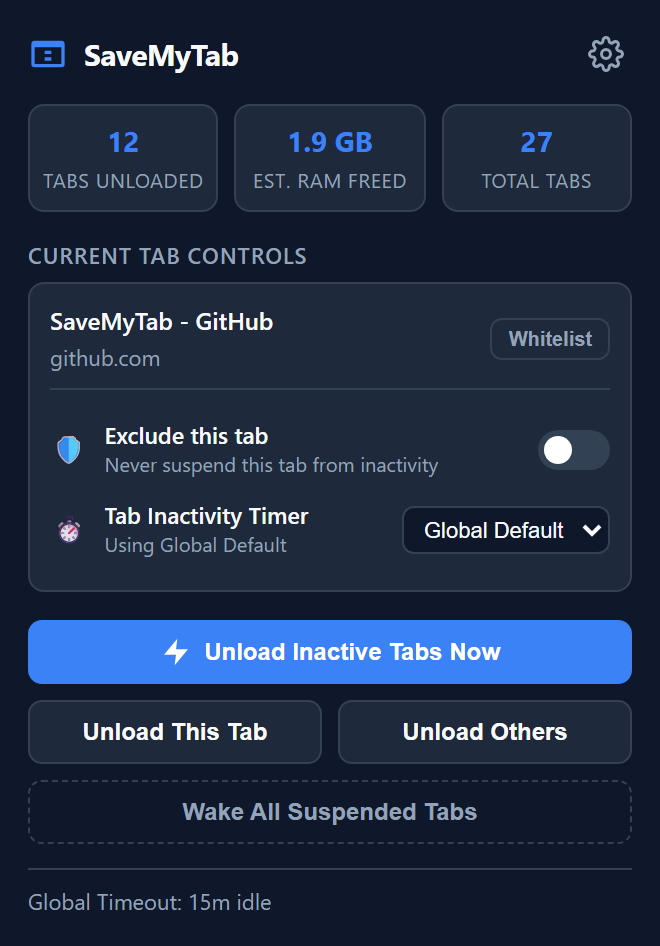
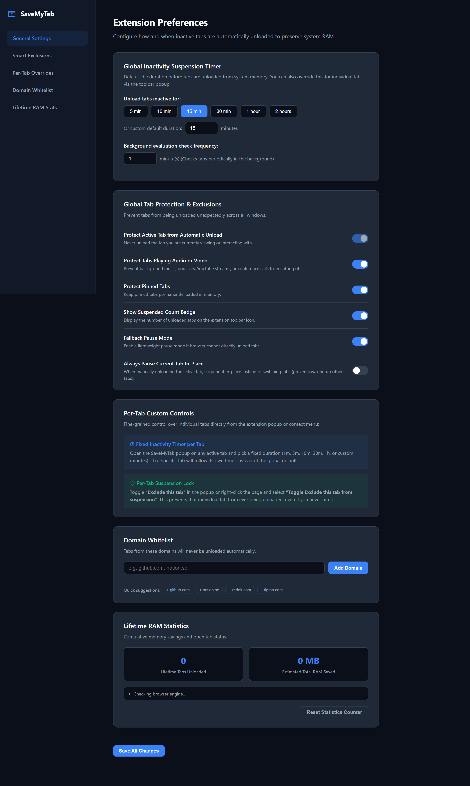
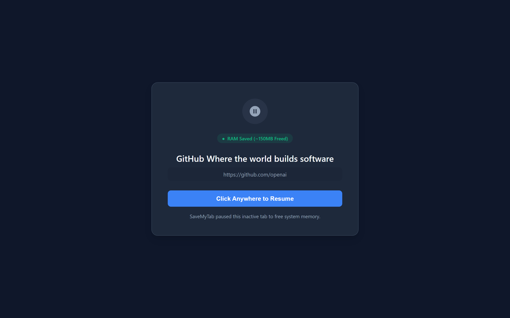

<div align="center">

# 💾 SaveMyTab

**Universal Cross-Browser Tab Unloader & Memory Saver**

An open-source, high-efficiency WebExtension (Manifest V3) that intelligently unloads inactive tabs to drastically reduce your browser's memory footprint — using native memory-discard APIs with a zero-RAM pause fallback, without disrupting your workflow.



**Chrome · Firefox · Edge · Brave · Opera · Safari**

[](#license)


</div>

---

## Why it exists

Modern web apps (social feeds, docs suites, video players, webmail) routinely eat **100–600 MB+ of RAM per tab**. Keeping 20–50 tabs open ties up **4–16 GB of memory**, causing OS slowdowns, battery drain, and a browser that stutters on every tab switch.

SaveMyTab puts that memory back, automatically — while keeping every tab exactly where you left it.

## What it does

### 🧠 Dual-Engine Memory Reclamation

| Engine | How it works | Result |
| :--- | :--- | :--- |
| **Native Discard** (primary) | Calls `tabs.discard(tabId)` — the browser's own unload API | Releases 100% of the tab's DOM, CSS and JS heap. Tab stays visible with its title, URL and favicon; wakes instantly on click |
| **Zero-RAM Pause** (fallback) | Swaps the active tab for a ~10 KB static placeholder | ~10 KB footprint, greyscale favicon + 💤 badge, one click to restore |

### ✨ Feature Highlights

- ⏱ **Per-Tab Custom Timers** — override the global timeout per tab (`1 min` → `2 hours`, or any custom duration) right from the popup
- 🛡 **Per-Tab Suspension Lock** — exclude any tab from suspension with one toggle; no pinning, no domain whitelisting
- ⚙️ **Global Inactivity Timer** — universal idle threshold (default: 15 min) with a configurable background check interval
- 🎬 **Smart Protections** — never touches your active tab, tabs playing audio/video (Meet, Zoom, Teams, YouTube), or pinned apps (toggleable)
- 🚫 **Domain Whitelist** — keep `docs.google.com`, `github.com`, `notion.so`… permanently awake, with quick-add chips
- 🌫️ **Visual Sleep Indicators** — sleeping tabs dim and grey out natively, paused tabs show 💤 in the title
- 🚀 **One-Click Control Center** — live unloaded-tab counter, real-time RAM-freed estimate, and bulk actions
- 🖱 **Context Menu Shortcuts** — unload, lock, or whitelist a site from any right-click

## See it in action

<div align="center">

**Extension Preferences — timers, protections, whitelist & lifetime stats**



**The Pause Screen — what a suspended tab looks like (click anywhere to resume)**



</div>

From the toolbar popup you can run a manual cleanup across all windows, unload just the current tab, unload all others, wake every sleeping tab at once, or whitelist the site you're on.

### 🖱 Right-Click Shortcuts

Right-click any page to: unload/suspend the tab · toggle the exclusion lock · unload all other tabs · run an instant cleanup · add the domain to your whitelist.

---

## Installation

### Chrome · Edge · Brave · Opera

1. Clone or download this repository.
2. Open your browser's extension page:
   - **Chrome**: `chrome://extensions` · **Edge**: `edge://extensions` · **Brave**: `brave://extensions` · **Opera**: `opera://extensions`
3. Enable **Developer mode** (top-right).
4. Click **Load unpacked** and select the folder containing `manifest.json`.
5. Pin SaveMyTab to your toolbar.

### Firefox

1. Open `about:debugging#/runtime/this-firefox`.
2. Click **Load Temporary Add-on…** and pick `manifest.json`.

> 💡 To see Firefox's native tab unloading in action anytime, visit `about:unloads`.

### Safari

1. Enable developer features: **Safari → Settings → Advanced → Show features for web developers**.
2. Convert and build with Xcode:
   ```bash
   xcrun safari-web-extension-converter /path/to/SaveMyTab
   ```

---

## Browser Compatibility

| Browser | Background Runtime | Tab Discard Engine | Status |
| :--- | :--- | :--- | :--- |
| **Google Chrome** | Service Worker | native `chrome.tabs.discard` | ✅ Fully Supported |
| **Microsoft Edge** | Service Worker | native `chrome.tabs.discard` | ✅ Fully Supported |
| **Brave** | Service Worker | native `chrome.tabs.discard` | ✅ Fully Supported |
| **Opera / Vivaldi** | Service Worker | native `chrome.tabs.discard` | ✅ Fully Supported |
| **Mozilla Firefox** | Event Page | native `browser.tabs.discard` | ✅ Fully Supported |
| **Apple Safari** | WebExtension | native `browser.tabs.discard` | ✅ Fully Supported |

Built on the official WebExtensions Manifest V3 spec, with dual background declarations (`scripts` + `service_worker`) for universal support.

---

## Configuration

Open Settings via the ⚙ icon in the popup:

| Setting | What it controls |
| :--- | :--- |
| **Inactivity Timer** | Global idle duration before tabs unload (5m – 2h, or custom) |
| **Check Frequency** | How often the background alarm evaluates tabs (1–60 min) |
| **Active Tab Protection** | Never unload the tab you're using (enforced) |
| **Audio & Video Protection** | Spare background media and meetings |
| **Pinned Tab Protection** | Keep pinned apps permanently loaded (toggleable) |
| **Always Pause In-Place** | Suspend the active tab without switching focus |
| **Domain Whitelist** | Domains that are never unloaded |
| **Lifetime Statistics** | Cumulative tabs unloaded & total RAM saved |

---

## Repository Structure

```
savemytab-extension/
├── manifest.json              # Cross-browser Manifest V3 configuration
├── background.js              # Service worker / event page (alarms, lifecycle, discard)
├── popup/
│   ├── popup.html / .css / .js   # Toolbar popup: stats & quick actions
├── options/
│   ├── options.html / .css / .js # Settings dashboard
├── fallback/
│   ├── paused.html / .js         # Zero-RAM pause placeholder
└── icons/                        # Toolbar & sleep-state icons
```

---

## Privacy & Security

- **100% local execution** — all analysis, timers, and unloading happen inside your browser
- **Zero remote network calls** — no telemetry, tracking, or analytics of any kind
- **No sensitive data stored** — only settings (timeouts, whitelist domains) in `chrome.storage`
- **Zero content injection** — never inspects or alters webpage content

---

## Show it some love ⭐

If SaveMyTab frees up RAM for you, please **star this repo**, or **fork it and
showcase your setup** — every star, fork, and issue report helps other people
find a quieter browser.

---

## License

Open source under the MIT License.
